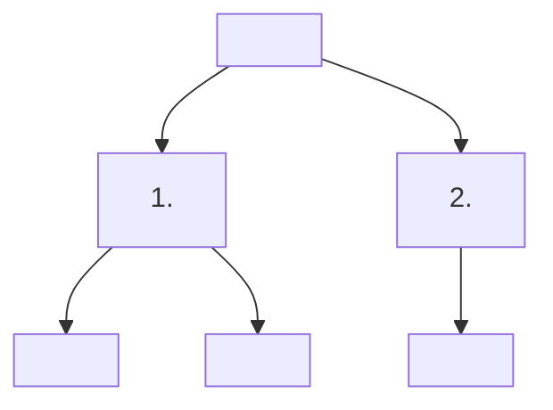

# Feature Map — <product name>

## Confidence

| Node(s) | Basis |
|---|---|
| <ids> | observed |
| <ids> | inferred — behind login / not tested |
| <ids> | proposed — added via feature-mapping / to-be-solved, not yet built |

## Structure note
<how the top level is organised — e.g. surfaces map 1:1 to user groups; parallel modes; etc.>

## Change log
<only once the blueprint has been updated at least once>
| Date | Node(s) | Change | Source |
|---|---|---|---|
