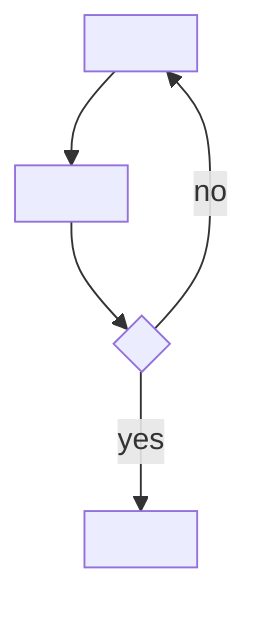

# J<n> — <journey name>

## Primary user goal
<one or two sentences: what the user is trying to achieve.>

## Journey

Single-actor journey — the usual case:

| Step | How the user would do it | Why the user would do it | Technical delights to ease pain |
|---|---|---|---|
| 1. <step> | <the interaction — what they tap/type/see> | <the rationale — tie to a persona need/goal/pain where possible> | <how the product can make this easier; prefer reusing a pattern already in `patterns.md`> |
| 2. <step> *(inferred)* | — | — | — |

Journey that crosses actors or surfaces (e.g. customer → admin → customer; a public app
handing off to an admin panel and back) — add an **Actor** column naming who performs each
step and where:

| Actor | Step | How the user would do it | Why the user would do it | Technical delights to ease pain |
|---|---|---|---|---|
| `<persona-slug>` (`<surface>`) | 1. <step> | ... | ... | ... |
| `<persona-slug>` (`<surface>`) | 2. <step> | ... | ... | ... |

Use whichever table fits this journey — don't carry an empty Actor column on a single-actor
one. Mark steps not directly observed `*(inferred)*`. For a bare, not-yet-enriched journey
the How / Why / Technical-delight columns may read `—` — enrich later.

## Core Experience
<one line distilling the whole journey — the sequence of questions the screen answers.>

## Flow diagram

## Business rules applied
<by step — e.g. "Step 1: BR-1, BR-4". Ids only; the rule text lives in `business-rules.md`.
A journey-design decision that creates a new rule is added there as `state: proposed`.>

## Notes
- <which steps are inferred and why; branch consequences; convergence points>

## Change log
<only for an updated journey — what changed from the prior `existing` version, and why>
| Date | Change | Driver |
|---|---|---|
